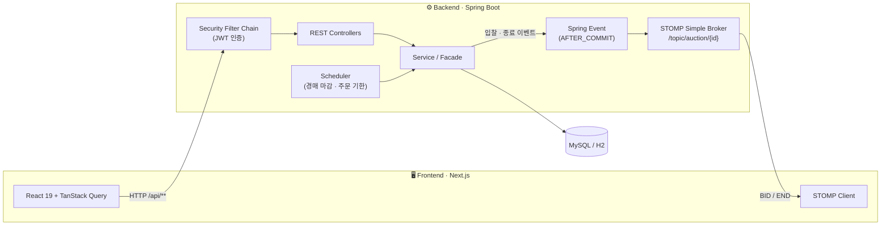
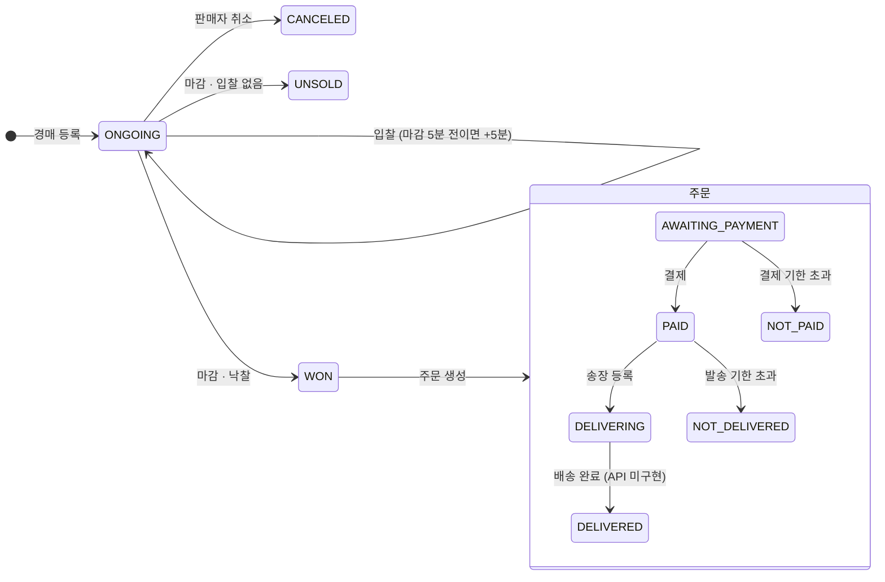

<div align="center">

# 🔨 실시간 경매 플랫폼

**누구나 판매하고, 실시간으로 입찰하는 온라인 경매 서비스**

2026 프로그래머스 데브코스 백엔드 2차 프로젝트 · 8팀

<br>


<br>


<br>


</div>

---

## 📑 목차

- [주요 기능](#-주요-기능)
- [아키텍처](#-아키텍처)
- [경매 · 주문 흐름](#-경매--주문-흐름)
- [기술적 고민](#-기술적-고민)
- [기술 스택](#-기술-스택)
- [프로젝트 구조](#-프로젝트-구조)
- [시작하기](#-시작하기)
- [API 개요](#-api-개요)
- [부하 테스트 (k6)](#-부하-테스트-k6)
- [협업 방식](#-협업-방식)

---

## ✨ 주요 기능

| 기능 | 설명 |
|---|---|
| 👤 **회원** | 회원가입 · 로그인, JWT Access Token + HttpOnly Refresh Token 쿠키 기반 인증 |
| 🏷️ **판매자 멤버십** | 판매 권한 신청 → 관리자 승인/반려 후 경매 등록 가능 |
| 📦 **경매** | 이미지와 함께 경매 등록 · 수정 · 취소, 목록/상세 조회, 내 경매 조회 |
| 💸 **실시간 입찰** | 입찰 즉시 WebSocket(STOMP)으로 같은 경매를 보는 모든 사용자에게 현재가 브로드캐스트 |
| ⏱️ **자동 연장** | 마감 5분 이내 입찰이 들어오면 종료 시각을 5분 연장 (스나이핑 방지) |
| 🧾 **주문 · 결제 · 배송** | 낙찰 시 주문 생성 → 배송지 입력 → 결제 → 송장 등록까지 |
| 🤖 **자동 상태 전이** | 스케줄러가 마감된 경매를 낙찰/유찰 처리하고, 기한 내 미결제·미발송 주문을 취소 |
| 🛡️ **관리자** | 판매자 멤버십 신청 심사 |

---

## 🏗️ 아키텍처



- 입찰이 **DB에 커밋된 뒤에만** 이벤트를 발행해, 롤백된 입찰가가 화면에 퍼지지 않도록 했습니다.
- 메시지는 `type`(`BID` / `END`)으로 구분하며, 프론트는 `END`를 받으면 경매 종료 처리 후 소켓을 닫습니다.

---

## 🔄 경매 · 주문 흐름



---

## 🧠 기술적 고민

<details>
<summary><b>1. 동시 입찰 — 같은 경매에 입찰이 몰릴 때 정합성 보장</b></summary>

<br>

마감 직전에는 한 경매에 입찰이 동시에 몰립니다. 두 가지 방식을 구현해 비교했습니다.

| 방식 | 엔드포인트 | 동작 |
|---|---|---|
| **낙관적 락** | `POST /api/auctions/bids` | `Auction`의 `@Version`으로 충돌 감지. 조회 → 검증 → 수정 순서 |
| **원자적 UPDATE** | `POST /api/auctions/bids/atomic` | 가격·입찰 단위·경매 상태·자기 입찰 여부를 `UPDATE ... WHERE` 한 문장으로 검증하고 갱신. 실패했을 때만 재조회로 원인 판별 |

원자적 UPDATE 방식은 DB가 직렬화를 보장하므로 재시도 없이 충돌을 처리하고, 마감 연장도 같은 쿼리에서 처리합니다.
비교 결과는 `k6/scripts/bid-concurrency-test.js` 로 재현할 수 있습니다.

</details>

<details>
<summary><b>2. 실시간 브로드캐스트 — 트랜잭션과 메시지의 순서</b></summary>

<br>

입찰 서비스는 `ApplicationEventPublisher`로 `BidEvent`를 발행하고, 리스너가 `@TransactionalEventListener(phase = AFTER_COMMIT)`에서 WebSocket으로 전송합니다.

- 서비스 코드가 WebSocket에 직접 의존하지 않음
- 커밋 실패(락 충돌 등) 시 메시지가 나가지 않음
- 메시지를 받은 클라이언트가 바로 조회해도 커밋된 값이 보임

</details>

<details>
<summary><b>3. 상태 전이 스케줄러 — 벌크 업데이트</b></summary>

<br>

경매 마감과 주문 기한 초과 처리는 1초 주기 스케줄러가 담당합니다.
주문 취소(`AWAITING_PAYMENT → NOT_PAID`, `PAID → NOT_DELIVERED`)는 한 트랜잭션 안의 벌크 UPDATE로 처리해 대상이 많아도 쿼리 수가 늘지 않습니다.

</details>

---

## 🛠️ 기술 스택

| 구분 | 사용 기술 |
|---|---|
| **Backend** | Java 25, Spring Boot 4.0.5, Spring Data JPA, Spring Security, Spring WebSocket (STOMP), jjwt 0.12, springdoc-openapi, Lombok |
| **Database** | MySQL 8.0 (운영), H2 (로컬 · 테스트) |
| **Frontend** | Next.js 16, React 19, TypeScript, Tailwind CSS v4, shadcn/ui (Base UI), TanStack Query v5, Zustand v5, React Hook Form + Zod v4, @stomp/stompjs |
| **Test** | JUnit 5, Spring Boot Test, Mockito, k6 |
| **Infra · Tool** | Docker Compose, InfluxDB, Grafana, GitHub Actions (Gemini AI PR 리뷰) |

---

## 📂 프로젝트 구조

```
.
├── backend/                         # Spring Boot API 서버
│   └── src/main/java/com/team8/backend
│       ├── domain/
│       │   ├── user/                # 회원 · 인증
│       │   ├── membership/          # 판매자 권한 신청 · 승인
│       │   ├── auction/             # 경매 등록 · 조회 · 마감 스케줄러
│       │   ├── bid/                 # 입찰 · 입찰 이벤트
│       │   └── order/               # 주문 · 결제 · 배송 · 기한 스케줄러
│       └── global/
│           ├── security/            # JWT 필터, SecurityConfig
│           ├── websocket/           # STOMP 설정, IP별 연결 제한
│           ├── exception/           # ErrorCode, 전역 예외 처리
│           └── response/            # 공통 응답 포맷 (ApiResponse)
├── frontend/                        # Next.js 클라이언트
│   ├── app/                         # (auth) 로그인·회원가입 / (main) 경매·주문·프로필 / admin
│   ├── components/
│   └── lib/                         # API 클라이언트, 소켓 훅, 인증
├── k6/                              # 부하 테스트 스크립트 · Grafana 대시보드
└── docker-compose.k6.yml            # MySQL + Backend + InfluxDB + Grafana + k6
```

---

## 🚀 시작하기

### 사전 요구사항

- JDK 25
- Node.js 20+
- (선택) Docker — 부하 테스트 환경용

### Backend

```bash
cd backend
./gradlew bootRun
```

- 기본 실행 시 파일 기반 H2(`./db_dev`)를 사용하므로 별도 DB 없이 바로 실행됩니다.
- API 서버: `http://localhost:8080`
- Swagger UI: `http://localhost:8080/swagger-ui.html`

| 환경 변수 | 설명 | 기본값 |
|---|---|---|
| `SPRING_DATASOURCE_URL` | DB 접속 URL | `jdbc:h2:./db_dev;MODE=MySQL` |
| `SPRING_DATASOURCE_USERNAME` / `PASSWORD` | DB 계정 | `sa` / (빈 값) |
| `JWT_SECRET` | JWT 서명 키 (32자 이상) | 테스트용 기본 키 |
| `IS_COOKIE_SECURE` | Refresh Token 쿠키 `Secure` 여부 | `false` |

> ⚠️ 운영 환경에서는 반드시 `JWT_SECRET`을 별도 값으로 지정하세요.

### Frontend

```bash
cd frontend
npm install
npm run dev     # http://localhost:3000
```

`frontend/.env.local`

```env
NEXT_PUBLIC_API_URL=http://localhost:8080
NEXT_PUBLIC_WS_URL=ws://localhost:8080/ws
NEXT_PUBLIC_USE_MOCK=false   # true면 백엔드 없이 목 데이터로 UI 확인
```

자세한 프론트엔드 개발 가이드는 [frontend/CONTRIBUTING.md](frontend/CONTRIBUTING.md)를 참고하세요.

### 테스트

```bash
cd backend
./gradlew test
```

---

## 📡 API 개요

전체 명세는 Swagger UI에서 확인할 수 있습니다.

| 도메인 | Method | Endpoint | 설명 |
|---|---|---|---|
| **User** | `POST` | `/api/users/signup` | 회원가입 |
| | `POST` | `/api/users/login` | 로그인 |
| | `POST` | `/api/users/refresh` | Access Token 재발급 |
| | `POST` | `/api/users/logout` | 로그아웃 |
| | `GET` `PUT` | `/api/users/me` | 내 정보 조회 · 수정 |
| **Membership** | `POST` | `/api/membership/apply` | 판매자 권한 신청 |
| | `GET` | `/api/membership` | 신청 목록 (관리자) |
| | `PATCH` | `/api/membership/{id}` | 승인 · 반려 (관리자) |
| **Auction** | `GET` | `/api/auctions` | 경매 목록 |
| | `GET` | `/api/auctions/{auctionId}` | 경매 상세 |
| | `POST` | `/api/auctions` | 경매 등록 (multipart) |
| | `PATCH` | `/api/auctions/{auctionId}` | 경매 수정 (multipart) |
| | `DELETE` | `/api/auctions/{auctionId}` | 경매 취소 |
| | `GET` | `/api/auctions/me` | 내가 등록한 경매 |
| **Bid** | `POST` | `/api/auctions/bids` | 입찰 (낙관적 락) |
| | `POST` | `/api/auctions/bids/atomic` | 입찰 (원자적 UPDATE) |
| | `GET` | `/api/auctions/{auctionId}/bids` | 경매별 입찰 내역 |
| | `GET` | `/api/bids/me` | 내 입찰 내역 |
| **Order** | `GET` | `/api/orders/me` | 내 주문 (구매/판매) |
| | `GET` | `/api/orders/{orderId}` | 주문 상세 |
| | `POST` | `/api/orders/{orderId}/shipping` | 배송지 입력 |
| | `POST` | `/api/orders/{orderId}/pay` | 결제 |
| | `POST` | `/api/orders/{orderId}/tracking` | 송장 등록 |

**WebSocket** — `/topic/auction/{auctionId}` 구독

```json
{ "type": "BID", "data": { "auctionId": 10, "bidPrice": 2000, "bidderId": 2, "bidedAt": "...", "nickname": "..." } }
```

---

## 📈 부하 테스트 (k6)

MySQL · Backend · InfluxDB · Grafana · k6를 한 번에 띄워 테스트하고 결과를 대시보드로 확인합니다.

```bash
# 기본 시나리오 (동시 입찰 테스트)
docker compose -f docker-compose.k6.yml up

# 다른 시나리오 실행
docker compose -f docker-compose.k6.yml run --rm k6 \
  run --out influxdb=http://influxdb:8086/k6 /scripts/stress-test.js
```

| 스크립트 | 목적 |
|---|---|
| `smoke-test.js` | 최소 부하로 기본 동작 확인 |
| `load-test.js` | 평상시 예상 트래픽 |
| `stress-test.js` | 한계 지점 탐색 |
| `spike-test.js` | 순간 트래픽 급증 |
| `bid-concurrency-test.js` | 한 경매에 동시 입찰 집중 |

Grafana 대시보드: `http://localhost:3000`

---

## 🤝 협업 방식

- **브랜치 전략** — `main` ← `dev` ← `feat/*`, `fix/*`, `refactor/*`
- **커밋 컨벤션** — `feat:`, `fix:`, `refactor:`, `test:`, `docs:` 등 접두어 사용
- **PR** — [PR 템플릿](.github/PULL_REQUEST_TEMPLATE.md)에 맞춰 작성, `dev` · `main` 대상 PR에는 Gemini 기반 [AI 코드 리뷰](.github/workflows/ai-pr-review.yml)가 자동으로 달림
- **이슈** — [이슈 템플릿](.github/ISSUE_TEMPLATE)으로 작업 단위 관리
